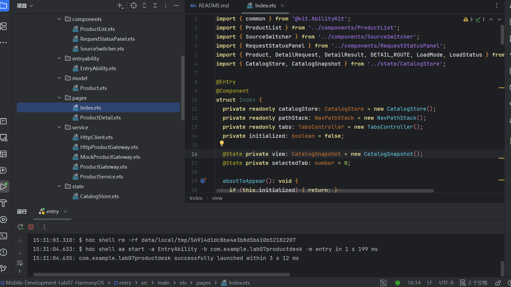
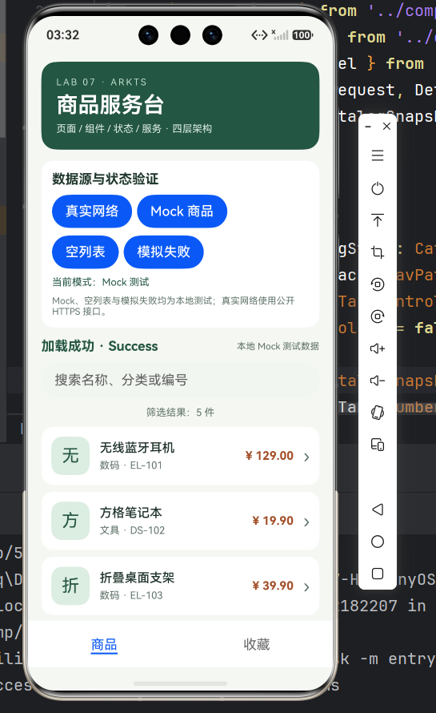
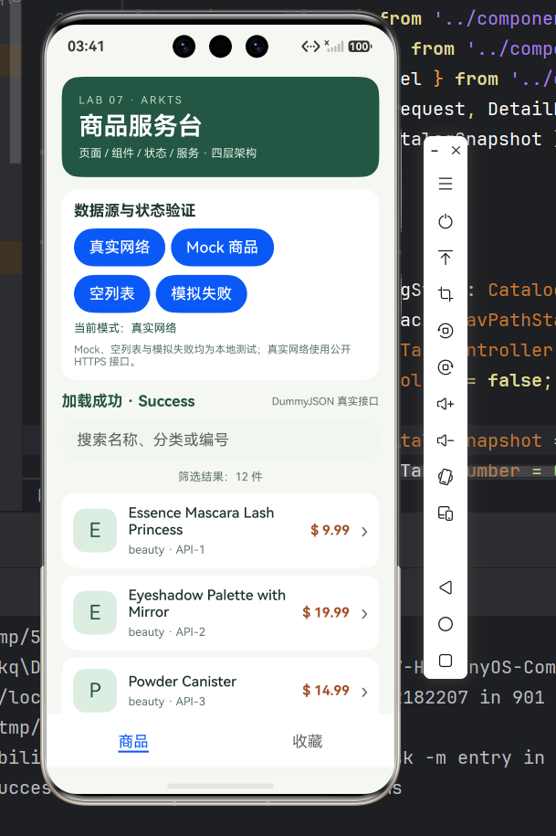
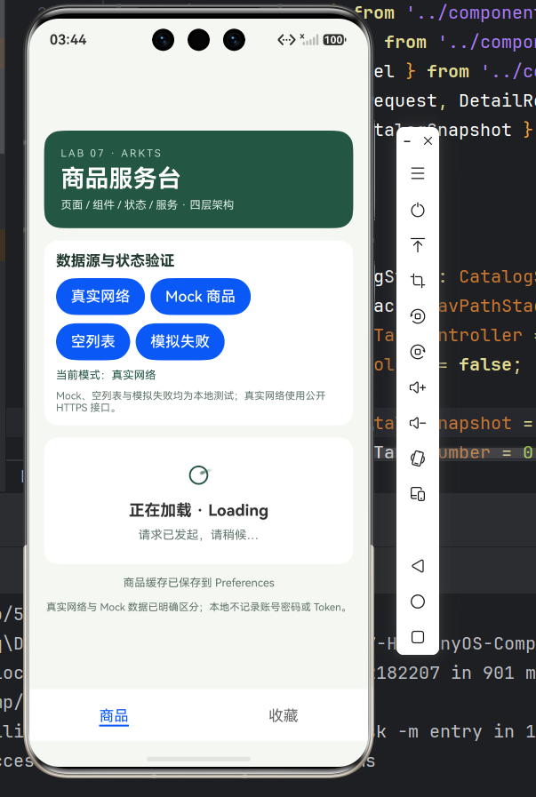
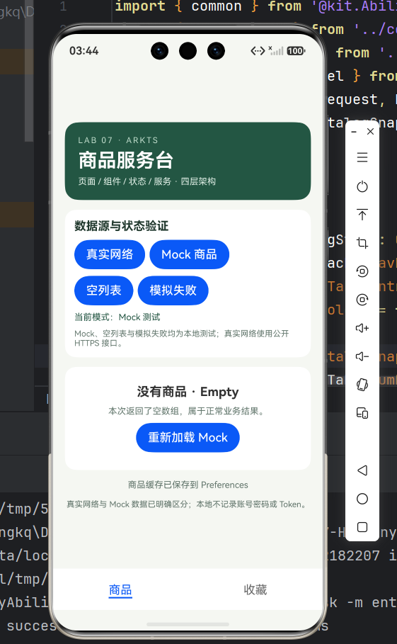
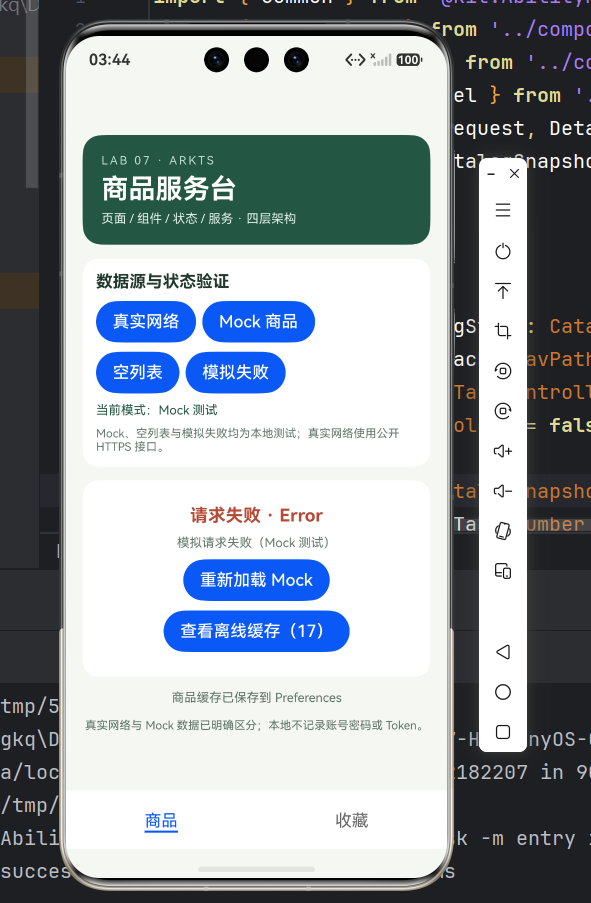
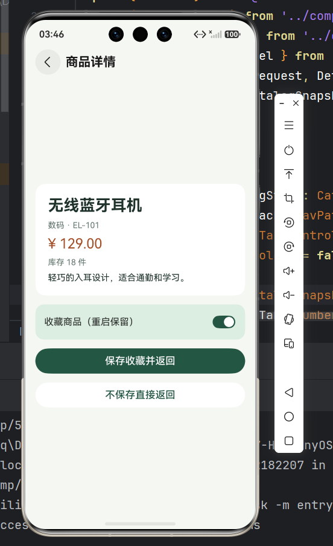
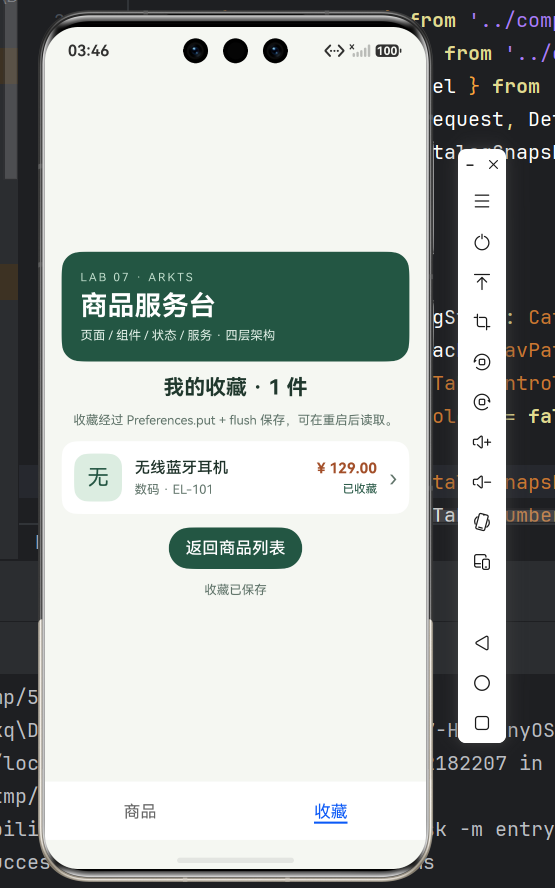

# 实验七 · 商品服务台（HarmonyOS ArkTS）

基于 DevEco Studio 的原生 HarmonyOS 商品应用。支持本地 Mock 商品展示、真实 HTTPS 请求、商品搜索与详情、收藏持久化，以及 Loading / Success / Empty / Error 状态。工程采用**页面层—组件层—状态层—服务层**四层组织，并提供需求、接口、原型、测试和答辩资料。

## 开发环境

- DevEco Studio 26.0.0（工程 `modelVersion=26.0.0`）
- HarmonyOS 手机模拟器；项目目标为 phone
- ArkTS / ArkUI；NetworkKit、ArkData Preferences
- 无需单独启动后端，真实接口使用 DummyJSON 公开演示服务

## 在 DevEco Studio 中运行

1. 使用 **File → Open** 选择含 `oh-package.json5`、`build-profile.json5` 的本工程根目录。
2. 等待 IDE 完成 Hvigor / SDK 同步。选择 `entry` 运行配置和已启动的 HarmonyOS 手机模拟器。
3. 首次启动显示明确标识的 **Mock 商品**；可切换「真实网络」「Mock 商品」「空列表」「模拟失败」。
4. 点击商品查看详情，切换收藏并保存返回；在底部「收藏」页查看结果。完全关闭应用后再运行，验证 Preferences 数据恢复。
5. 使用 **Build** 菜单构建 HAP；通过设备实际运行后截取截图，按 `screenshots/README.md` 命名。

> 工程以此前的商品应用为起点完成四层重构。已提供 DevEco Studio 实际运行截图，包含启动日志、Mock 和真实网络请求成功、异步状态、详情与收藏；截图对应本次应用运行。完整 HAP 安装包需在本地 DevEco Studio 构建生成。

## 代码分层

```text
entry/src/main/ets/
├── pages/                     # 页面：Navigation、Tab、路由回传
│   ├── Index.ets
│   └── ProductDetail.ets
├── components/                # UI 组件：商品列表、数据源切换、状态提示
│   ├── ProductList.ets
│   ├── SourceSwitcher.ets
│   └── RequestStatusPanel.ets
├── state/                     # 领域状态、请求并发控制、KV 持久化
│   ├── CatalogStore.ets
│   └── ProductPreferences.ets
├── service/                   # 契约及数据服务（HTTP / Mock）
│   ├── ProductGateway.ets
│   ├── ProductService.ets
│   ├── HttpClient.ets
│   ├── HttpProductGateway.ets
│   └── MockProductGateway.ets
└── model/Product.ets          # 跨层数据契约、路由参数、业务枚举
```

页面通过状态层发起操作；状态层依赖服务层并发布新的完整快照；服务层根据数据模式选择真实网络或 Mock；模型定义是跨层共享的简单数据契约。

## 功能与行为

| 功能 | 实现与验证点 |
| --- | --- |
| 异步加载 | `Promise` / `async-await`；Loading/Success/Empty/Error |
| 来源区分 | 默认 Mock，真实网络由用户点击触发，标题可见来源 |
| 商品列表 | 展示名称、分类、价格、编号、收藏标记 |
| 搜索 | 商品名称、分类与编号的本地筛选 |
| 详情路由 | `Navigation` + `NavPathStack.pushPathByName()`，返回 `DetailResult` |
| Tab | 底部「商品 / 收藏」，不将 Tab 当作详情页压栈 |
| 收藏存储 | Preferences 写入 ID；等待 `flush()` 后更新收藏状态 |
| 离线缓存 | 存储公开商品数据，网络失败时可选择查看上次缓存 |
| 并发保护 | 请求序号使过期请求结果不会覆盖后一次选择 |

## 文档与检查

- [需求与验收标准](docs/01-需求分析.md)
- [四层架构与数据流](docs/02-系统架构.md)
- [接口先行与 Mock 契约](docs/03-接口文档.md)
- [页面原型与交互说明](docs/04-原型设计.md)（另有 `docs/prototype.html` 可用浏览器打开）
- [协作与 feature 评审记录模板](docs/05-团队协作与评审.md)
- [测试计划与结果登记](docs/06-测试计划.md)
- [答辩演示材料](docs/07-答辩材料.md) 与 [答辩 PPTX](docs/答辩演示.pptx)
- [工程伦理与引用](docs/08-工程伦理与引用.md)
- [打包交付步骤](docs/09-打包与交付.md)

在本地安装 Node.js 后可运行不依赖 HarmonyOS SDK 的**契约静态测试**：

```bash
node tests/contract.test.mjs
```

该测试只验证契约与工程配置，不能代替 ArkTS 编译或模拟器测试。


## 运行截图

以下为 DevEco Studio 模拟器/开发环境实际截取的画面。真实网络成功与 Mock 模式已按截图中可见的数据来源分别标注。

| 编号 | 场景 | 截图 |
| --- | --- | --- |
| 01 | DevEco Studio 四层目录与成功启动日志 |  |
| 02 | Mock 模式加载商品成功 |  |
| 03 | 真实 HTTPS 请求加载成功（DummyJSON 12 件） |  |
| 04 | 异步加载中（Loading） |  |
| 05 | 空列表状态（Empty） |  |
| 06 | Mock 失败模拟（Error）与缓存入口 |  |
| 07 | 商品详情及收藏开关 |  |
| 08 | 收藏页显示已保存商品 |  |

以上截图分别证明对应界面及操作结果。收藏页截图显示已保存商品，但单张截图不单独证明进程关闭后再次恢复；如答辩需验证持久化，可按测试计划实际关闭应用、重新启动并再次确认。

## 数据与工程伦理

- DummyJSON 是演示 API；真实接口返回与 Mock 数据明确区分。Mock 价格和库存不是经营数据。
- 不在 Preferences 中保存密码、Token、Cookie 或个人隐私。运行失败必须展示真实错误，不伪造成功截图。
- **AI 辅助声明**：本次工程重构、部分 ArkTS 实现和文档初稿使用了 AI 辅助生成；代码逻辑与文件结构做过静态检查，但 DevEco Studio 构建、模拟器操作与实际截图需要由提交者亲自验证。详见 `docs/08-工程伦理与引用.md`。

## 外部参考

- [HarmonyOS Navigation / NavPathStack](https://developer.huawei.com/consumer/en/doc/HarmonyOS-Guides/arkts-navigation-jump/)
- [HarmonyOS Preferences](https://developer.huawei.com/consumer/en/doc/HarmonyOS-Guides/data-persistence-by-preferences/)
- [DummyJSON Products API](https://dummyjson.com/docs/products)
