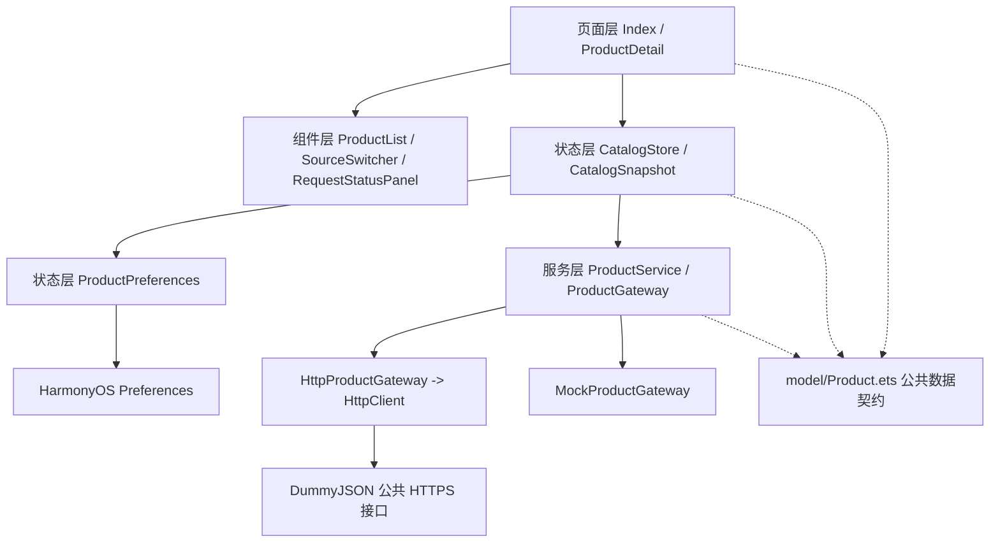

# 二、系统架构（四层）

## 页面层

`Index.ets` 管理 `Navigation`、底部 Tabs、UI 绑定及业务事件转发；`ProductDetail.ets` 负责参数校验、详情呈现、返回时回传 `DetailResult`。页面**不负责拼装 HTTP 请求或直接操作 Preferences**。

## 组件层

`ProductList.ets` 只负责商品卡片与点击事件；`SourceSwitcher.ets` 只负责发送数据模式选择事件；`RequestStatusPanel.ets` 封装加载、空列表、错误重试和缓存入口。可由其他页面复用，不依赖具体服务实现。

## 状态层

`CatalogStore.ets` 持有 `CatalogSnapshot`，执行状态转换、请求序号防抖、缓存合并、搜索筛选与收藏更新。每次写入都返回新快照，页面通过 `@State view` 整体替换刷新。`ProductPreferences.ets` 负责持久化读写及 `flush`。

## 服务层

`ProductGateway.list(): Promise<Product[]>` 是先定义的接口；`HttpProductGateway` 通过 `HttpClient` 请求并校验数据；`MockProductGateway` 返回确定的本地数据、空数组或抛出可预期的错误。`ProductService` 依据 `LoadMode` 选择实现，不让页面决定底层细节。

## 关键数据流

**加载流程：** 数据源点击 → `CatalogStore.load` 发布 Loading → `ProductService.list` → 真实接口或 Mock → 更新 Success / Empty / Error → 保存成功列表到 Preferences → 发布最新快照。

**收藏流程：** 商品卡点击 → `Navigation.pushPathByName` → 详情页修改 Toggle → `pop(DetailResult)` → `CatalogStore.changeFavorite` → `Preferences.put + flush` → 保存成功后更新 UI；写入失败时保留原状态。

**冲突与缓存：** 每次加载分配递增 `generation`；响应返回时比对是否仍是当前请求，过期响应被丢弃。离线缓存仅存储公开商品字段；该实现不进行任意数据同步或云端用户状态合并。

## 取舍

本项目数据规模小，使用单一 `CatalogStore` 而非复杂全局状态库。`@State` 使用快照整体替换以降低 ArkTS 深层对象变更不刷新的风险。请求序号不取消底层 HTTP 连接，但能阻止过期结果覆盖页面。
